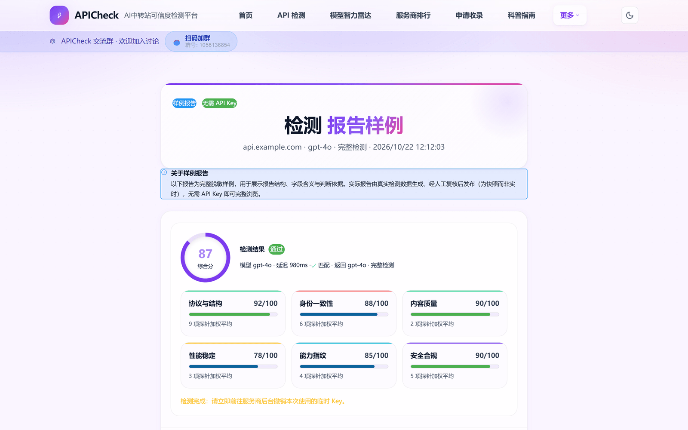
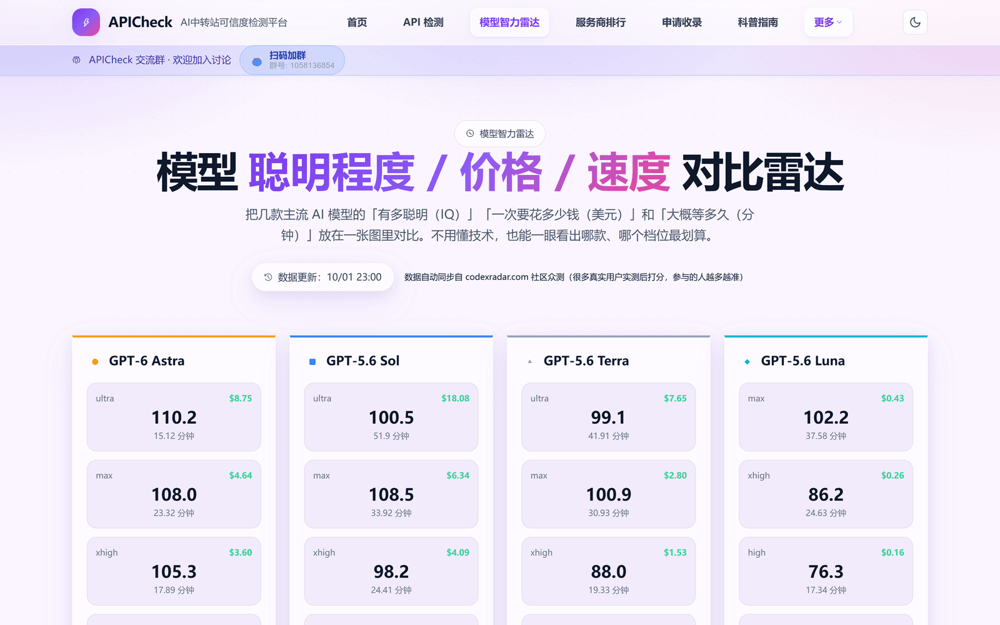

  

  
  
  
  

> **APICheck** 帮你快速判断一个 AI API 中转 / 代理服务**是否可用、模型是否真实、有没有被偷偷降智、响应是否稳定**，并附一份**人工维护**的服务商参考排行，作为选型与比对的起点。

## 它解决什么问题

在你接入某个中转服务之前，APICheck 帮你把含糊的「它靠不靠谱」变成一次可验证的检测：

- 这个 API **能不能用**？Key 填进去会不会石沉大海？
- 服务商宣称的 `gpt-5.6` / `claude` 等，是**真模型还是套壳**？
- 回答越来越敷衍，是不是**被降智**了（思考预算被压平、上下文被偷偷截断）？
- 几十家中转站，到底**哪家更稳、更透明、更靠谱**？
- 想**安全地测试自己的 Key**，又不想把它暴露在不可信的工具里。

## 核心能力

- **单次检测，两档可选**：粘贴端点与 Key，立即发起真实请求。快速档约 3–5 分钟出结论，完整档通常 3–8 分钟，覆盖更全。
- **模型真实性核验**：响应 `model` 字段与模型自报身份是否一致、是否套壳伪装；再看**模型指纹**（与离线指纹库的群体一致性）、可信基线比对与 Nonce 重放，多层交叉。
- **降智与能力塌陷检测**：同一道难题在低/高推理档位各跑一次，比对服务端上报的 reasoning token 与正确率，识别思考预算被压平；再让模型画一只骑自行车的鹈鹕，看输出结构是否完整、有没有偷懒拒答。
- **隐性降级观测**：发一段很长的文档验证**上下文窗口**是否被悄悄砍短；用响应头与 TLS 特征判断**端点归属**（官方直连还是第三方网关）；核对 token 用量是否被虚报、缓存是真命中还是只写不读。
- **安全与协议合规**：HTTPS 传输、固定 Token 注入、提示词覆盖、错误信息泄露、SSE 流完整性，以及流式 / 非流式的协议契约一致性。
- **不止单点检测**：批量检测、人工维护的服务商参考排行、模型智力雷达（IQ / 成本 / 耗时）、技能资源市场与技术文章。

> 检测过程在你的授权下进行，API Key 经 HTTPS 传输、仅用于本次检测，不写入数据库或持久化保存；详见 [安全说明](https://apicheck.vip/security)。

## 检测覆盖

完整档共 **30 项探针**（快速档 14 项，跳过长耗时项），按六个维度加权成综合分：

| 维度 | 看什么 | 代表探针 |
| --- | --- | --- |
| **身份一致性** | 返回的模型是不是它宣称的那个 | 身份一致性、隐式身份与包装审计、身份证据评分、模型指纹、基线比对、Token 对账 |
| **协议与结构** | 接口通不通、格式对不对 | 协议连通性、接口心跳、响应结构、响应签名、文档识别、缓存创建与命中、协议契约、错误契约、端点归属、上下文窗口实测 |
| **能力指纹** | 能力是不是真货 | 能力指纹、多模态、推理档位校验（降智）、输出结构校验（画鹈鹕） |
| **安全合规** | 会不会偷你的东西 | 传输安全、Token 注入、指令覆盖、错误信息泄露、Nonce 重放检测 |
| **性能稳定** | 快不快、稳不稳 | 响应时延（TTFT）、性能稳定性、流完整性 |
| **内容质量** | 让它做的事有没有做到 | 内容 Canary、结构化输出 |

其中「端点归属」与「上下文窗口实测」是**描述性探针**，只在报告里展示、不参与加权——本工具测的就是中转站，把「第三方网关」当扣分项等于无差别惩罚所有被测对象。

## 一次检测长什么样

报告收敛为 **一个综合分 + 六维拆解**，不再并排摆几个互相打架的分数：

- **没测到 ≠ 不及格**：超时、被上游掐断、模型本身不支持的能力，一律标「未测到 / 不适用」，不计 0 分、也不从分母里虚增权重。
- **快速档与完整档不可直接比大小**：快速档跳过了长耗时探针，分数口径不同，页面会明确提示。
- **只反映检测时刻**：单次结果不代表长期状态，同一端点换节点、换时段都可能不同。

## 工作流程

  

一次检测长这样：粘贴中转站地址与 Key → 发起 30 项真实请求 → 拿到一份可读报告（综合分、六维拆解、每项探针的原始输出与判定依据），并对照人工维护的排行。

## 数据口径与边界

⚠️ **排行榜为人工维护数据，不是实时自动监控。**

- 服务商排行由编辑团队**定期人工更新**，参考公开资料、社区反馈与抽样检测，不代表实时服务状态。
- 单次检测结果仅反映**检测时刻**的该端点表现，不构成长期承诺；用户自测结果**不会自动改榜**。
- 指纹类结论（模型指纹、端点归属）判定的是**与已知基线的相似度**，不是绝对归属；样本不足时输出「样本不足」而不做推测。
- 我们不对排行的绝对准确性或商业决策后果作担保；它应作为**参考起点**，而非唯一依据。
- 如需更严谨的评估，请结合自身业务做多次、多角度验证。

## 技术栈

以下为公开、非敏感的技术概览：

- 前端：React + TypeScript + Vite，静态预渲染（SSG）
- 后端：Node.js + Express + tRPC
- 数据库：PostgreSQL + Drizzle ORM
- 部署：Docker + Nginx / Caddy

（出于安全与商业考虑，服务器地址、环境变量、密钥、内部架构与部署脚本**不公开**。）

## 开始使用

1. 打开官网 [apicheck.vip](https://apicheck.vip/)，在「API 检测」页粘贴中转站端点与你的 Key；
2. 选择**快速检测**（约 3–5 分钟）或**完整检测**（3–8 分钟）；
3. 等待报告：一个综合分 + 六维拆解，可展开看每项探针的判定依据；
4. 需要时对照 [服务商排行](https://apicheck.vip/rankings) 做选型比对，或去 [模型智力雷达](https://apicheck.vip/model-radar) 看各模型档位的性价比。

## 官网入口

- 首页 / 检测：[https://apicheck.vip/](https://apicheck.vip/)
- 服务商排行：[https://apicheck.vip/rankings](https://apicheck.vip/rankings)
- 批量检测：[https://apicheck.vip/batch](https://apicheck.vip/batch)
- 模型智力雷达：[https://apicheck.vip/model-radar](https://apicheck.vip/model-radar)
- 技能市场：[https://apicheck.vip/skills](https://apicheck.vip/skills)
- 技术文章：[https://apicheck.vip/articles](https://apicheck.vip/articles)
- 检测方法论：[https://apicheck.vip/methodology](https://apicheck.vip/methodology)
- 报告样例：[https://apicheck.vip/sample-report](https://apicheck.vip/sample-report)
- 项目介绍：[https://apicheck.vip/project](https://apicheck.vip/project)
- 安全说明：[https://apicheck.vip/security](https://apicheck.vip/security)

## 页面截图

> 以下截图均为公开页面，不含任何 API Key、token、后台地址或用户数据。

  
  

  
  

## 近期更新

**2026-10**

- 新增**上下文窗口实测**探针：发长文档验证中转站有没有偷偷截断（宣称 200K、实际 32K）。
- **文档识别**探针真正落地（此前只是占位）；**缓存**探针升级为「缓存创建与命中」，能区分只写不读的号池。
- 报告页定形为**一个主分 + 六维拆解**，修掉「高分 · 失败」自相矛盾与分数不同源的问题。
- 统一「没测到」口径：超时、不支持、被掐断不再算 0 分，也不再把抖动写成身份造假。
- API 增加限流、反向代理信任链校验与 Docker 资源限额。

**2026-09**

- 新增**推理档位校验（降智检测）**：低/高思考档位各跑一次，比对 reasoning token 与正确率。
- 新增**输出结构校验（画鹈鹕）**：固定 prompt 生成 SVG，按客观规则判定结构完整性。
- 新增**模型指纹**（移植自 modelprint，MIT）与**端点归属**探针，报告里增加降智趋势。
- 原生协议（Anthropic / Gemini）检测链路开放，不再只走 OpenAI 兼容格式。
- 站上所有「共 N 项探针」文案改为单一事实源，不再硬编码漂移。

**2026-08**

- 新增**模型智力雷达**：主流模型在不同推理档位下的 IQ / 成本 / 耗时对比（数据同步自 codexradar.com 社区众测）。
- 新增**技术文章**系统，记录检测方法与项目来龙去脉。

**2026-07（本页上次更新之后）**

- 新增**技能市场**：AI 技能资源库、详情页、资源包下载、社区提交与后台审核。
- 新增**批量检测**与分层评分视图，一次提交多个端点。

## 源代码与许可

本仓库仅用于**项目介绍与文档展示**。**APICheck 的产品源代码未公开**，不在本仓库中分发，也不以开源许可证提供。更完整的项目介绍见 [官网 /project](https://apicheck.vip/project)。

本仓库未包含开源许可证。在未另行授权的情况下，仓库内容（含文档与截图）保留所有权利；产品源代码未授予他人使用许可。

---

*APICheck · 让 AI API 中转站的选择更透明*
