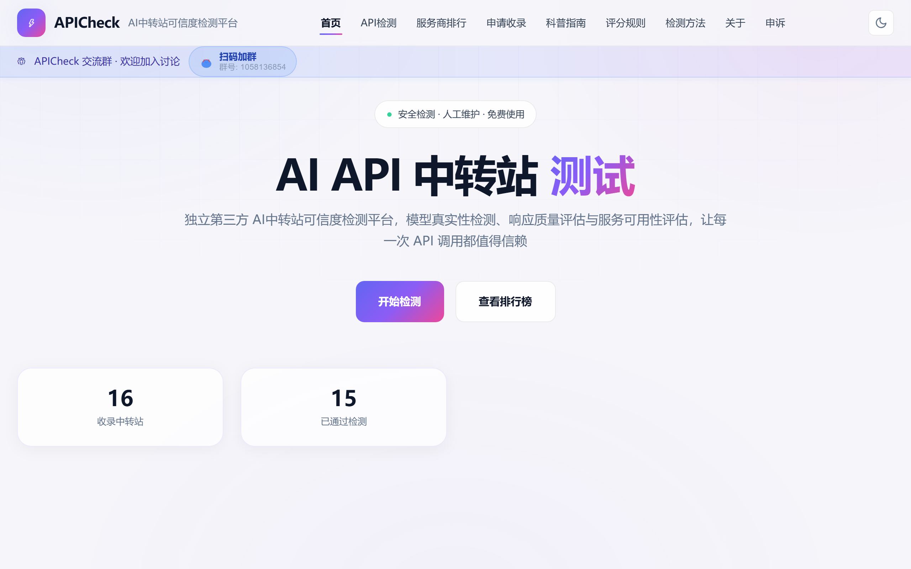
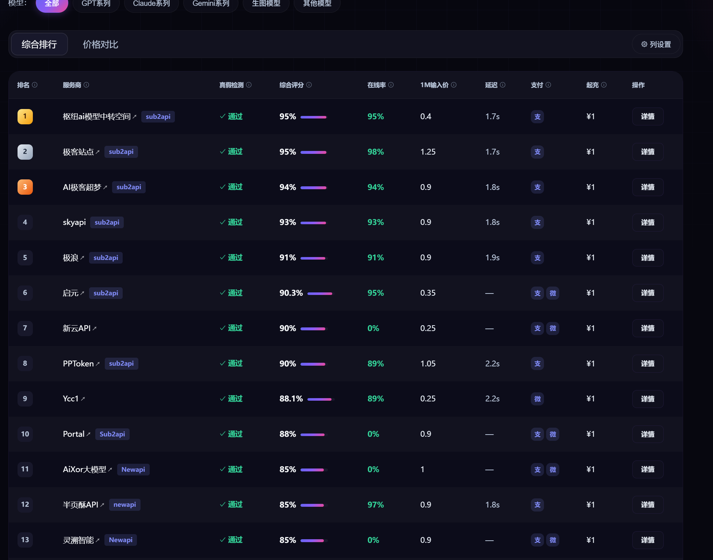

# APICheck

> AI API 中转站单次检测与服务商参考排行平台

APICheck 帮助你快速判断一个 AI API 中转 / 代理服务**是否可用、模型是否真实、响应是否稳定**，并提供一份**人工维护**的服务商参考排行榜，作为选型与比对的起点。

🌐 官网：[https://apicheck.vip](https://apicheck.vip)

---

## 项目定位

APICheck 是一个面向普通用户与开发者的 **AI API 中转站检测与参考平台**。我们不替你跑业务流量，而是帮助你：

- 在接入某个中转服务前，**安全地验证它是否真的可用**；
- 判断它宣称的模型是否**真实存在、与官方一致**；
- 对比不同服务商的**稳定性、透明度与合规性**；
- 参考一份**人工维护**的服务商排行，少走弯路。

## 用户问题

你是否曾经遇到过这些疑问：

- 这个 API 到底**能不能用**？Key 填进去会不会石沉大海？
- 服务商宣称的 `gpt-4o` / `claude` 等模型，是**真模型还是套壳**？
- 几十家中转站，到底**哪家更稳、更透明、更靠谱**？
- 我想**安全地测试自己的 API Key**，又不想把密钥暴露在不可信的工具里。

APICheck 把这些问题变成一次「检测 → 一份可读报告 → 一个参考排行」。

## 核心能力

- **单次 API 检测**：粘贴一个端点和 Key，立即发起一次真实请求，验证连通性与基本可用性。
- **模型真实性评估**：对返回内容做多维度校验，判断模型身份与声明是否一致，识别套壳 / 伪装。
- **响应质量检查**：检查延迟、错误率、协议合规、内容完整度等，形成可量化结论。
- **人工维护服务商参考排行**：由编辑团队结合公开信息、用户反馈与抽样检测，人工整理服务商参考榜，覆盖稳定性、透明度、合规等维度。

> 检测过程在你的授权下进行，APICheck 不会留存你的业务数据；详见 [安全说明](https://apicheck.vip/security)。

## 数据口径

⚠️ **排行榜为人工维护数据，不是实时自动监控。**

- 服务商排行由编辑团队**定期人工更新**，参考公开资料、社区反馈与抽样检测，不代表实时服务状态。
- 单次检测结果仅反映**检测时刻**的该端点表现，不构成长期承诺。
- 我们不对排行的绝对准确性或商业决策后果作担保；它应作为**参考起点**，而非唯一依据。
- 如需更严谨的评估，请结合自身业务做多次、多角度验证。

## 技术栈

以下为公开、非敏感的技术概览：

- 前端：React + TypeScript + Vite
- 后端：Node.js + tRPC
- 数据库：PostgreSQL
- 部署：Docker + Nginx / Caddy

（出于安全与商业考虑，服务器地址、环境变量、密钥、内部架构与部署脚本**不公开**。）

## 官网入口

- 首页：[https://apicheck.vip/](https://apicheck.vip/)
- 服务商排行：[https://apicheck.vip/rankings](https://apicheck.vip/rankings)
- 检测方法：[https://apicheck.vip/methodology](https://apicheck.vip/methodology)
- 项目介绍：[https://apicheck.vip/project](https://apicheck.vip/project)
- 安全说明：[https://apicheck.vip/security](https://apicheck.vip/security)

## 截图

> 以下截图均为公开页面，不含任何 API Key、token、后台地址或用户数据。

| 页面 | 截图 |
| --- | --- |
| 首页 |  |
| 服务商排行 |  |
| 检测方法 |  |

## 源代码

本仓库仅用于**项目介绍与文档展示**。**APICheck 的产品源代码未公开**，不在本仓库中分发，也不以开源许可证提供。更完整的项目介绍见 [官网 /project](https://apicheck.vip/project)。

## 许可

本仓库未包含开源许可证。在未另行授权的情况下，仓库内容（含文档与截图）保留所有权利；产品源代码未授予他人使用许可。

---

*APICheck · 让 AI API 中转站的选择更透明*
